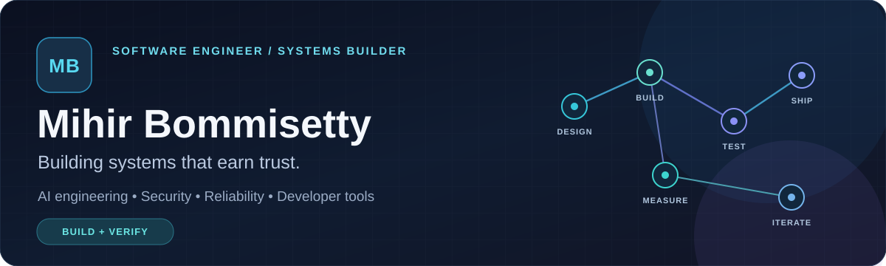
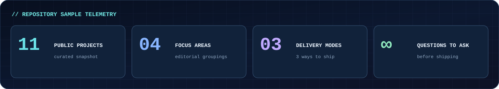
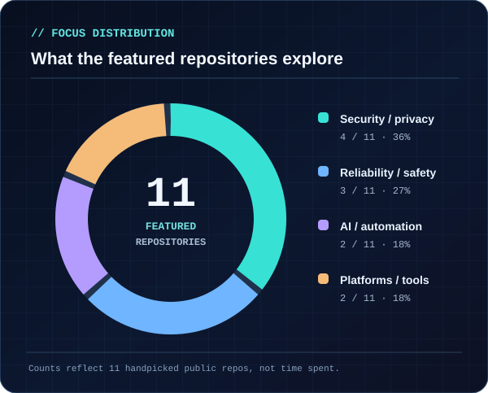
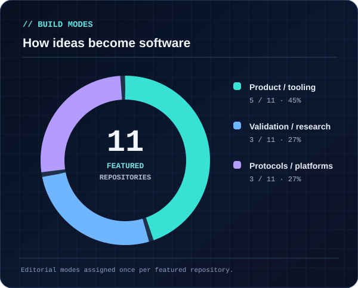
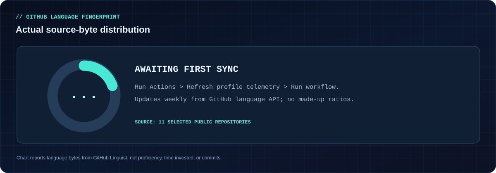
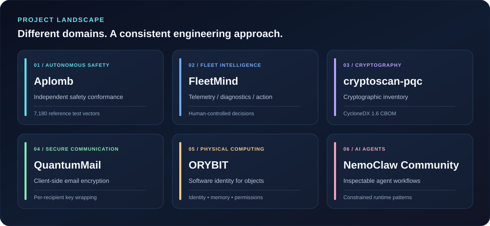
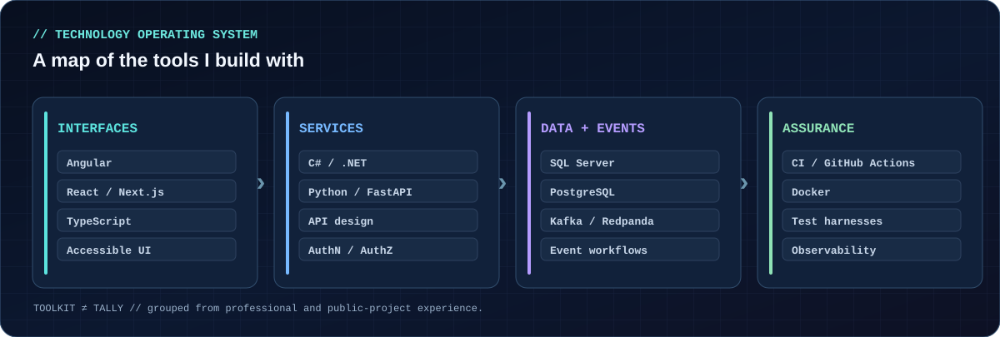
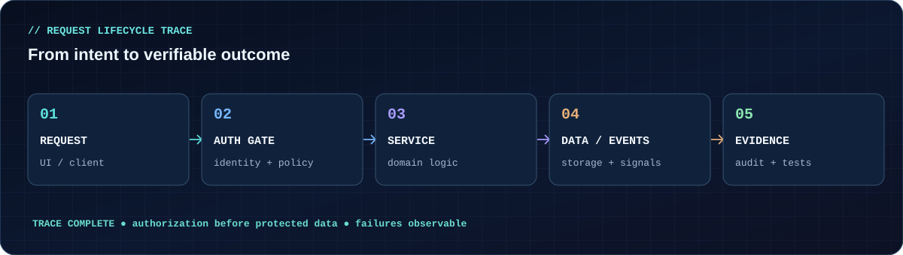
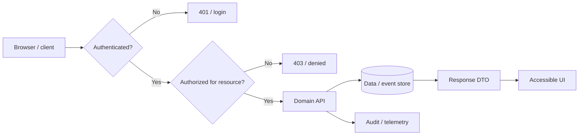
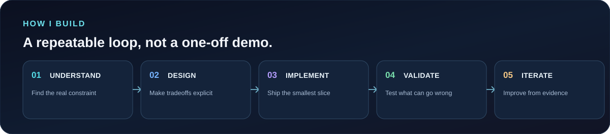

<div align="center">



[](https://www.linkedin.com/in/mihirbommisetty/)
[](https://github.com/munnamihir?tab=repositories)


<sub><code>[ SYSTEMS ]</code> · <code>[ SECURITY ]</code> · <code>[ AI INFRASTRUCTURE ]</code> · <code>[ TRUSTWORTHY SOFTWARE ]</code></sub>

**[PROJECTS](#-select-a-mission)** &nbsp;•&nbsp; **[TELEMETRY](#-portfolio-telemetry)** &nbsp;•&nbsp; **[STACK](#-tech-stack)** &nbsp;•&nbsp; **[LAB](#-open-the-lab-console)** &nbsp;•&nbsp; **[CONTACT](#-establish-connection)**

</div>

## `> whoami`

I'm **Mihir Bommisetty** — a software engineer with a master's in Computer Science from **Stevens Institute of Technology**.

I build full-stack systems professionally using **C# / .NET, Angular, and SQL Server**, with a focus on APIs, authorization, modernization, and accessibility. Outside my day job, I experiment with **AI agents, reliability engineering, software security, and systems that connect the physical and digital worlds**.

> **My design constraint:** if a system makes an important claim, I want to know what evidence backs it up.

<div align="center">

</div>

## 📊 Portfolio telemetry

These are **two pie charts about an explicitly curated set of 11 public repositories**. They are *not* percentages of my time, skill, or contributions. See the exact categorization in the expandable panel below.

<table>
<tr>
<td width="50%"></td>
<td width="50%"></td>
</tr>
</table>

<details>
<summary><b>🧮 Inspect the data behind both pies (11 repositories)</b></summary>

| Repository | Focus | Delivery mode |
| --- | --- | --- |
| [cryptoscan-pqc](https://github.com/munnamihir/cryptoscan-pqc) | Security / privacy | Validation / research |
| [QuantumMail-v2](https://github.com/munnamihir/QuantumMail-v2) | Security / privacy | Product / tooling |
| [CipherGuard](https://github.com/munnamihir/cipherguard) | Security / privacy | Product / tooling |
| [PNEUMA](https://github.com/munnamihir/pneuma-db) | Security / privacy | Protocols / platforms |
| [Aplomb](https://github.com/munnamihir/aplomb) | Reliability / safety | Validation / research |
| [FleetMind](https://github.com/munnamihir/fleetmind) | Reliability / safety | Product / tooling |
| [Shift-aware scheduling](https://github.com/munnamihir/shift-aware-scheduling) | Reliability / safety | Validation / research |
| [NemoClaw Community](https://github.com/munnamihir/nemoclaw-community) | AI / automation | Protocols / platforms |
| [LinkedIn Fixer](https://github.com/munnamihir/linkedin-fixer) | AI / automation | Product / tooling |
| [ORYBIT](https://github.com/munnamihir/orybit) | Platforms / tools | Protocols / platforms |
| [SaaS Radar](https://github.com/munnamihir/Saas-radar) | Platforms / tools | Product / tooling |

These groupings are an editorial lens on a curated sample. The repository set is not an exhaustive catalog of my account.

</details>

### 📡 Live language fingerprint



<sub>When initialized, this panel refreshes **every Monday** from GitHub's repository language API. Language share measures **source-code bytes**, not experience or proficiency. The panel stays in a clearly marked “awaiting first sync” state until [the workflow](./.github/workflows/refresh-telemetry.yml) is run in this profile repository.</sub>

## 🕹️ Select a mission

<div align="center"></div>

| `MISSION` | `SYSTEM` | `WHAT IT DOES` |
| :--- | :--- | :--- |
| `01 // SAFETY` | **[Aplomb](https://github.com/munnamihir/aplomb)** | Independent conformance testing for autonomous-driving safety computations. |
| `02 // FLEETS` | **[FleetMind](https://github.com/munnamihir/fleetmind)** | Evidence-based predictive reliability and fleet decision workflows. |
| `03 // CRYPTO` | **[cryptoscan-pqc](https://github.com/munnamihir/cryptoscan-pqc)** | Find cryptographic primitives and generate a CycloneDX CBOM. |
| `04 // PRIVACY` | **[QuantumMail](https://github.com/munnamihir/QuantumMail-v2)** | Client-side encrypted email flows and per-recipient key wrapping. |
| `05 // OBJECTS` | **[ORYBIT](https://github.com/munnamihir/orybit)** | Persistent identity, ownership and capabilities for physical objects. |
| `06 // AGENTS` | **[NemoClaw Community](https://github.com/munnamihir/nemoclaw-community)** | Inspectable agent workflows with explicit execution boundaries. |

## 🧰 Tech stack

<div align="center"></div>

**Languages:** `C#` `TypeScript` `JavaScript` `Python` `SQL`  
**Frameworks:** `.NET` `Angular` `React` `Next.js` `FastAPI`  
**Infrastructure & tooling:** `SQL Server` `PostgreSQL` `Docker` `GitHub Actions` `Kafka / Redpanda`  
**Engineering interests:** `Authentication / Authorization` `AI Agents` `Safety Validation` `Post-Quantum Security` `Observability`

## 🔭 Architecture thinking

<div align="center"></div>

<details>
<summary><b>↳ View the deeper request-flow blueprint (expand)</b></summary>

The diagram below is an *illustrative* architecture pattern, not a schematic of a specific employer's proprietary system.



**Design rule:** authentication establishes identity; authorization gates access to the *specific* resource. Logs and tests make failure paths observable.

</details>

## 🧪 Open the lab console

<details>
<summary><b>▸ <code>cat /lab/security.md</code> — cryptography and trust</b></summary>

My public experiments include [cryptoscan-pqc](https://github.com/munnamihir/cryptoscan-pqc), [QuantumMail](https://github.com/munnamihir/QuantumMail-v2), and [PNEUMA](https://github.com/munnamihir/pneuma-db).

Questions I keep coming back to: **Who can decrypt? Where are keys? What happens after compromise? Can we verify the claim independently?**

</details>

<details>
<summary><b>▸ <code>cat /lab/reliability.md</code> — reality vs. simulation</b></summary>

[Aplomb](https://github.com/munnamihir/aplomb) investigates what ordinary testing misses in driving safety monitors; [FleetMind](https://github.com/munnamihir/fleetmind) explores explainable fleet reliability decisions. I care about **reference behavior, reproducible tests, and human control**.

</details>

<details>
<summary><b>▸ <code>cat /lab/agents.md</code> — AI systems with boundaries</b></summary>

[NemoClaw Community](https://github.com/munnamihir/nemoclaw-community) explores constrained agent workflows. My interests extend to **evaluation, tool permissions, observable actions, and accelerated inference infrastructure**.

</details>

<details>
<summary><b>▸ <code>sudo reveal-philosophy</code> — easter egg</b></summary>

```text
$ systemctl status curiosity
● curiosity.service — active (running)
  Debugging      : relentless
  Assumptions    : challenged
  Evidence       : required
  Final boss     : edge cases

> BUILD SMALL. VERIFY OFTEN. SHIP RESPONSIBLY.
```

If you opened this, we probably enjoy the same kind of engineering conversations.

</details>

## 🔁 Build → validate → iterate

<div align="center"></div>

## 🛰️ Currently exploring

- AI infrastructure and efficient inference workloads.
- Defensible AI agents: tools, permission boundaries, traceability, and evaluation.
- Security and safety tooling that makes hidden failures visible.

---

<div align="center">

## 🤝 Establish connection

**I'm interested in ambitious engineering problems where trust, systems performance, and real-world constraints matter.**

[](https://www.linkedin.com/in/mihirbommisetty/)
[](https://github.com/munnamihir?tab=repositories)

<sub>`END OF TRANSMISSION` · Built with Markdown, SVG, Mermaid, GitHub Actions and a curiosity problem.</sub>

</div>
