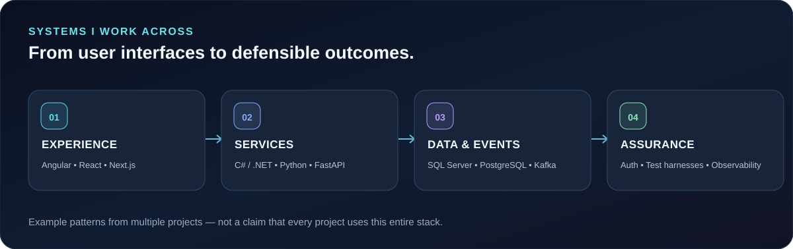

 

## Hello — I'm Mihir 👋

I'm a software engineer with a master's degree in Computer Science from **Stevens Institute of Technology**. Professionally, I work on complex full-stack applications using **C#, .NET, Angular, and SQL Server**, including modernization, API design, authorization, and usability.

Outside work, I explore the intersection of **AI, security, reliability, and physical systems**. I care about the parts that take an idea beyond a demo: testability, clear boundaries, observable behavior, and honest evidence.

> **Engineering philosophy:** evidence over assumptions · clear interfaces over complexity · measurable behavior over buzzwords.

## What I'm building

  

| Project | Why it exists |
| :--- | :--- |
| 🚘 **[Aplomb](https://github.com/munnamihir/aplomb)** | Independently check autonomous-driving safety-distance calculations against reference behavior and targeted defect cases. |
| ⚙️ **[FleetMind](https://github.com/munnamihir/fleetmind)** | Turn fleet telemetry into predictive reliability signals, diagnostic evidence, and human-controlled operational decisions. |
| 🔐 **[cryptoscan-pqc](https://github.com/munnamihir/cryptoscan-pqc)** | Discover cryptography in source code and output CycloneDX cryptographic bills of materials for post-quantum readiness. |
| ✉️ **[QuantumMail](https://github.com/munnamihir/QuantumMail-v2)** | Integrate client-side, per-recipient encrypted communication into familiar email workflows. |
| 🧩 **[ORYBIT](https://github.com/munnamihir/orybit)** | Explore persistent identity, capabilities, ownership, memory, and APIs for physical objects. |
| 🤖 **[NemoClaw Community](https://github.com/munnamihir/nemoclaw-community)** | Demonstrate inspectable AI-agent patterns with explicit runtime and integration boundaries. |

## Where I work in the stack

  

### Technologies & tools

**Languages & frameworks**

**Data, tooling & delivery**

## My engineering loop

  

## What I'm exploring next

- **AI infrastructure and accelerated computing** — making intelligent software more efficient, dependable, and useful.
- **Trustworthy agents** — bounded permissions, observable actions, evaluation, and verifiable outcomes.
- **Safety and security engineering** — independent validation, post-quantum readiness, and predictable failure behavior.

---

### Let's build something that matters.

Interested in **systems engineering, AI tooling, developer infrastructure, or security**?

**[Connect on LinkedIn](https://www.linkedin.com/in/mihirbommisetty/)** · **[Browse repositories](https://github.com/munnamihir?tab=repositories)**

Infographics are original SVG assets in <code>assets/</code>. Project diagrams are conceptual, not performance claims.

